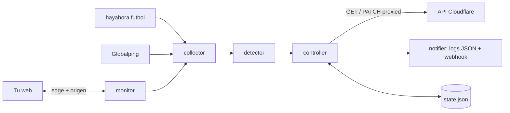

# laliga-guard

Microservicio en Go que detecta cuándo tu web deja de ser accesible desde operadoras españolas por los bloqueos de IPs de Cloudflare durante los partidos de LaLiga y, solo cuando hay evidencias externas suficientes, cambia los registros DNS que tú autorices de `proxied=true` a `proxied=false` hasta que el bloqueo termina.

**Arranca en `DRY_RUN=true` y así debe quedarse** hasta haber observado al menos una jornada de partidos y leer los [riesgos de DNS-only](#riesgos-de-activar-dns-only).

- Un binario, una imagen Docker de unos 18 MB, sin base de datos. El estado se guarda en un archivo JSON dentro de un volumen.
- No expone puertos. El endpoint de estado escucha en `127.0.0.1` dentro del contenedor.
- Solo usa la API oficial de Cloudflare con un API Token de permisos mínimos.

## El problema

Desde diciembre de 2024 una resolución judicial permite a LaLiga pedir a Movistar, Orange, Vodafone, DIGI y MásMóvil que bloqueen IPs durante los partidos. Muchas de esas IPs son de Cloudflare y las comparten miles de webs que no tienen nada que ver con el fútbol. Si tu web está detrás de Cloudflare y le toca una IP bloqueada, deja de cargar para una parte de tus visitantes en España.

Pasar el registro a DNS-only (nube gris) hace que los visitantes conecten directamente con tu servidor en lugar de con Cloudflare. Funciona, pero tiene costes serios (ver [riesgos](#riesgos-de-activar-dns-only)) y solo tiene sentido mientras dura el bloqueo. Este servicio automatiza ese cambio con muchas precauciones para no hacerlo por error.

## Cómo decide

Cada 30 segundos, por dominio:

1. Comprueba cada endpoint dos veces: a través de Cloudflare y conectando directamente al origen con el mismo Host y SNI.
2. Resuelve el dominio para saber qué IPs de Cloudflare está usando y las cruza con el feed de [hayahora.futbol](https://hayahora.futbol/), que mide bloqueos desde líneas domésticas de Movistar, Orange, Vodafone, DIGI y MásMóvil.
3. Si hay indicios (hayahora marca las IPs del dominio, o algo falla en la ruta por Cloudflare), lanza una medición HTTP con [Globalping](https://globalping.io/) desde sondas en esas operadoras y desde grupos de control. Como mucho una cada 10 minutos.
4. El detector clasifica el ciclo:

| Veredicto | Significado | Acción |
| --- | --- | --- |
| `healthy` | Nada que reportar | Ninguna |
| `origin_down` | El origen no responde en conexión directa | Alerta crítica. DNS-only no ayudaría |
| `app_error` | El origen responde 5xx | Alerta |
| `edge_issue` | Falla también desde el servidor del servicio o desde los controles | Alerta. No es un bloqueo selectivo |
| `block_suspected` | Solo una fuente externa indica bloqueo | Alerta, se mantiene el modo normal |
| `block_confirmed` | Dos fuentes externas independientes coinciden | Tras `min_failures` ciclos seguidos, contingencia |

Una comprobación hecha desde tu propio servidor o un error HTTP aislado nunca activan la contingencia. Al terminar el bloqueo restaura el proxy y no da la web por recuperada hasta que sondas externas lo confirman.



## Inicio rápido

Requisitos: Docker con Compose, un dominio en Cloudflare y un API Token (ver [permisos](#permisos-del-token-de-cloudflare)).

```bash
git clone https://github.com/alperdevv/laliga-bypass.git && cd laliga-bypass
cp config.example.yaml config.yaml   # dominios, zone_id, record_id y origen
cp .env.example .env                 # CF_API_TOKEN; deja DRY_RUN=true
docker compose run --rm laliga-guard validate
docker compose up -d --build
docker compose logs -f laliga-guard
```

`validate` hace solo lecturas: comprueba la configuración y que cada registro de Cloudflare coincide con lo esperado. Debe terminar con `Cloudflare read-only checks: OK`.

En los logs del primer ciclo verás `starting laliga-guard` con `"dry_run": true`, un `record verified` por registro y un `assessment_changed` por dominio con los motivos de cada fuente.

Sin Docker: `go test ./... && go run ./cmd/laliga-guard validate -config config.yaml` (Go 1.27 o superior).

## Configuración

Los secretos solo se leen del entorno; el YAML no debe contenerlos.

| Variable | Uso |
| --- | --- |
| `DRY_RUN` | `true` por defecto. Con `true` ningún registro se modifica nunca |
| `CF_API_TOKEN` | API Token de Cloudflare |
| `GLOBALPING_TOKEN` | Opcional. Sube la cuota de 250 a 500 tests/hora. Con uno o dos dominios no hace falta |
| `WEBHOOK_URL` | Opcional. Alertas de nivel warning y critical |
| `LOG_LEVEL` | `debug`, `info`, `warn`, `error` |
| `CONFIG_PATH` | Ruta del YAML. Por defecto `/etc/laliga-guard/config.yaml` |

Si se define `CF_API_KEY`, `CLOUDFLARE_API_KEY` o `CF_API_EMAIL` (Global API Key), el servicio se niega a arrancar.

Campos del YAML (ver [config.example.yaml](config.example.yaml)):

| Campo | Defecto | Descripción |
| --- | --- | --- |
| `poll_interval` | `30s` | Intervalo entre ciclos |
| `resolver` | `1.1.1.1:53` | Resolver para obtener las IPs de Cloudflare del dominio |
| `detector.min_isps` | `2` | Operadoras distintas con bloqueo para que una fuente cuente como positiva |
| `detector.min_confirming_sources` | `2` | Fuentes externas que deben coincidir para confirmar |
| `sources.hayahora.refresh_interval` | `5m` | Mínimo entre descargas del feed |
| `sources.hayahora.max_feed_age` | `30m` | Un feed más antiguo se ignora |
| `sources.hayahora.ignore_blocks_older_than` | `12h` | Bloqueos sin cambios desde hace más se consideran huérfanos |
| `sources.globalping.min_interval` | `10m` | Mínimo entre mediciones por host |
| `sources.globalping.baseline_interval` | `0s` | Medición periódica aunque no haya indicios. 0 la desactiva |
| `sources.globalping.targets` / `controls` | 5 operadoras / España (IONOS) y Alemania | Grupos de sondas con la sintaxis `magic` de Globalping |
| `controller.min_failures` | `3` | Ciclos seguidos con bloqueo confirmado antes de actuar |
| `controller.recovery_window` | `10m` | Tiempo continuo sin bloqueo antes de restaurar |
| `controller.max_contingency` | `60m` | Alerta crítica si la contingencia dura más (no restaura por tiempo) |
| `controller.min_change_interval` | `15m` | Mínimo entre dos cambios de DNS del mismo dominio |
| `controller.verify_delay` | `6m` | Espera tras restaurar antes de verificar (TTL de 300 s más margen) |
| `controller.verify_timeout` | `45m` | Alerta si la recuperación no se verifica en este plazo |
| `controller.manual_hold` | `6h` | Pausa de la automatización si alguien cambia los registros a mano |
| `domains[].endpoints` | | URLs a comprobar y códigos esperados |
| `domains[].origin.address` | | `host:puerto` del origen para la comprobación directa. Obligatorio |
| `domains[].canary_host` | | Host proxied de la misma zona que nunca se toca. Permite medir Cloudflare durante la contingencia |
| `domains[].records` | | Allowlist: `record_id`, `expected_type` (A, AAAA o CNAME), `expected_name`, `expected_content` |

Los umbrales no son un detector por sí mismos. Solo filtran evidencias que ya vienen de fuentes externas.

### Encontrar `zone_id` y `record_id`

El `zone_id` aparece en el panel de Cloudflare, en la página de resumen del dominio. Para los `record_id`:

```bash
curl -s -H "Authorization: Bearer $CF_API_TOKEN" \
  "https://api.cloudflare.com/client/v4/zones/$ZONE_ID/dns_records" \
  | jq '.result[] | select(.type=="A" or .type=="AAAA" or .type=="CNAME") | {id, name, type, content, proxied}'
```

Incluye todos los registros que sirven la web. Si `www` es un CNAME al dominio raíz, añade los dos: si solo cambias el raíz, `www` seguirá pasando por Cloudflare.

### Qué registros no conviene gestionar

- Hosts protegidos con **Cloudflare Access**: en DNS-only quedan abiertos sin login.
- Hosts que solo existen como **redirección configurada en Cloudflare**: el origen no sabe responder y en DNS-only se rompen.
- CNAME a otras plataformas (Pages, Railway, Vercel...): DNS-only no cambia nada o rompe el dominio personalizado.
- Correo, MX, TXT o cualquier registro que no sea web. El servicio rechaza tipos distintos de A, AAAA y CNAME.

### Comprobación directa del origen

La comprobación directa necesita llegar al origen sin pasar por Cloudflare. Desde el contenedor, la IP pública del propio servidor a veces no responde (NAT en bucle o un firewall que solo acepta rangos de Cloudflare). Opciones:

- `address: "203.0.113.10:443"`, la IP pública del servidor, si el firewall lo permite.
- `address: "<contenedor-del-proxy>:443"` si el servicio comparte red Docker con tu proxy inverso (Traefik, Caddy, Nginx).
- `address: "172.17.0.1:443"`, el gateway de Docker, si el proxy publica el 443 en el host.

Si el origen usa un certificado Cloudflare Origin CA, la verificación TLS fallará. Puedes poner `insecure_skip_verify: true`, pero entonces **la contingencia no funcionará para tus visitantes**: ver riesgos.

## Permisos del token de Cloudflare

Crea un API Token en *My Profile → API Tokens → Create Custom Token*:

| Permiso | Necesario | Para qué |
| --- | --- | --- |
| Zone → DNS → Edit | Sí | Leer los registros y cambiar `proxied` |
| Zone → Zone → Read | No | Comprobar que el `zone_id` corresponde al dominio. Sin él, solo se avisa |

Nada más. Además:

- *Zone Resources*: **Include → Specific zone →** solo las zonas configuradas.
- *Client IP Address Filtering*: restringe a la IP de salida del servidor.
- Pon fecha de expiración y rótalo.
- No uses la Global API Key: el servicio la rechaza.

Cloudflare no ofrece permisos por registro, así que el token puede editar cualquier registro de la zona. La limitación a los registros autorizados la impone el servicio: el cliente rechaza cualquier registro fuera de la allowlist, o de tipo distinto de A, AAAA o CNAME, antes de hacer la petición.

## Despliegue

El repositorio incluye un `Dockerfile` multi-stage (imagen final distroless, usuario sin privilegios) y un `docker-compose.yml` con reinicio automático, sistema de archivos de solo lectura, sin capacidades y con límites de memoria y CPU.

### Con Docker Compose

Es lo que hace el [inicio rápido](#inicio-rápido). El compose monta `./config.yaml` en `/etc/laliga-guard/config.yaml`, carga `.env` y crea el volumen `laliga-guard-data` para `/data`.

### Con `docker run`

```bash
docker build -t laliga-guard:1.0.0 --build-arg VERSION=1.0.0 .
docker volume create laliga-guard-data
docker run -d --name laliga-guard --restart unless-stopped \
  --env-file .env \
  -v "$PWD/config.yaml:/etc/laliga-guard/config.yaml:ro" \
  -v laliga-guard-data:/data \
  --read-only --cap-drop ALL --security-opt no-new-privileges:true \
  --memory 64m --cpus 0.25 \
  laliga-guard:1.0.0
```

### En cualquier otra plataforma

Cualquier plataforma que construya un `Dockerfile` sirve. Lo único que necesita el contenedor:

| Qué | Dónde |
| --- | --- |
| Variables de entorno | las de `.env.example` |
| Archivo de configuración | montado en `/etc/laliga-guard/config.yaml` |
| Volumen persistente | montado en `/data` |
| Puertos y dominios | ninguno; el servicio no recibe tráfico |

La imagen corre como el usuario 65532 y trae un `HEALTHCHECK` que falla si el servicio deja de completar ciclos. Si montas `/data` desde una ruta del host, ejecuta antes `chown 65532:65532` sobre ella.

### Comandos útiles

```bash
docker exec laliga-guard laliga-guard status     # estado persistido en JSON
docker exec laliga-guard laliga-guard validate   # comprobaciones de solo lectura
```

### Actualizar

`git pull`, reconstruye la imagen y recrea el contenedor (`docker compose up -d --build`). El estado está en el volumen: si había una contingencia activa, el nuevo contenedor la retoma. El servicio se niega a arrancar con un estado corrupto o de versión desconocida en lugar de olvidar cambios pendientes.

### Pasar a modo automático

Solo tras observar al menos una jornada de partidos en dry-run y con las [condiciones](#limitaciones-y-condiciones-para-el-modo-automático) cumplidas. Pon `DRY_RUN=false` y recrea el contenedor. Si faltan requisitos, el servicio arranca en observación y emite `automatic_mode_refused`.

## Rollback

El servicio solo cambia `proxied` en los registros autorizados. Para deshacerlo:

**Opción A, con el CLI** (aplica las mismas comprobaciones que la restauración automática):

```bash
docker compose stop laliga-guard
docker compose run --rm laliga-guard rollback            # o: rollback -domain example.com
```

El rollback se niega a correr si el servicio sigue en marcha (hay un bloqueo exclusivo sobre el estado) y respeta `DRY_RUN`: con `true` no cambia nada.

**Opción B, a mano en Cloudflare**: activa la nube naranja de los registros. El servicio detecta el cambio en el siguiente ciclo, deja de gestionarlos (`manual_change_detected`, `contingency_released`) y pausa la automatización durante `manual_hold`.

**Desactivar el servicio**: `DRY_RUN=true` o detener el contenedor. Detenerlo no revierte nada: si había una contingencia activa, restaura los registros con la opción A o B.

## Riesgos de activar DNS-only

Léelos antes de pasar a `DRY_RUN=false`. Algunos no tienen vuelta atrás.

- **La IP del origen queda expuesta para siempre.** Mientras el registro está en DNS-only cualquiera la ve, y los servicios de DNS pasivo (SecurityTrails, Censys y similares) la guardan en su histórico. Volver a activar el proxy no la oculta. A partir de ahí se puede atacar el origen saltándose Cloudflare. Comprueba si ya la tienes expuesta por otros registros en DNS-only (subdominios `dev`, `media`, `mail`...).
- **Se pierde todo lo que hace Cloudflare**: WAF, rate limiting, protección DDoS, caché, reglas de redirección, Workers, Cloudflare Access.
- **El certificado del origen debe ser válido para navegadores.** Con un certificado Cloudflare Origin CA o autofirmado, tus visitantes verán un error TLS. Let's Encrypt en el proxy inverso sirve.
- **El firewall del origen debe aceptar tráfico de cualquier IP** en 80/443. Si solo admite rangos de Cloudflare, DNS-only deja la web caída para todos.
- **Cabeceras de IP real**: sin Cloudflare no llega `CF-Connecting-IP`. Revisa la configuración de proxies de confianza de tu aplicación.
- **No funciona si el operador bloquea también la IP del origen.**
- **Retardo del DNS**: los resolvers cachean la respuesta hasta el TTL (300 s en DNS-only). El cambio tarda minutos en llegar a los visitantes, en ambos sentidos.
- **Afecta a todos los visitantes**, no solo a los de operadoras bloqueadas.

Mitigaciones razonables: una IP dedicada para las webs afectadas, endurecer el origen antes (rate limiting en el proxy, fail2ban) y valorar si exponer el origen compensa unas horas de bloqueo parcial.

## Limitaciones y condiciones para el modo automático

Limitaciones conocidas:

- Las dos fuentes son de terceros, gratuitas y sin SLA. hayahora avisa de que su formato puede cambiar; Globalping tiene pocas sondas por operadora y su campo `failureSource` es experimental.
- hayahora solo sabe de las IPs que mide. Si las IPs de Cloudflare de tu dominio no están en su lista, esa fuente no aporta nada y, con la configuración por defecto, el servicio solo alertará: nunca confirmará un bloqueo.
- Una sonda de Globalping en el ASN de una operadora puede no estar sujeta al bloqueo (centros de datos) o estar desconectada.
- Sin `canary_host`, durante la contingencia solo hayahora puede decir que el bloqueo terminó.
- La comprobación del registro antes del `PATCH` usa `modified_on`. Entre la lectura y la escritura queda una ventana de milisegundos sin protección.
- Si el contenedor muere justo entre el `PATCH` y el guardado del estado, el registro queda en DNS-only sin que el servicio lo sepa. En el siguiente intento lo verá en DNS-only, abortará y avisará.
- El servicio no comprueba si el origen es accesible desde las operadoras bloqueadas una vez en DNS-only.
- Si el servidor donde corre el servicio está en una red que también aplica el bloqueo, las comprobaciones locales fallarán y el veredicto será `edge_issue`.

Condiciones necesarias para `DRY_RUN=false` (las tres primeras las comprueba el servicio al arrancar):

1. `CF_API_TOKEN` definido, con permisos mínimos y limitado a las zonas configuradas.
2. Al menos `min_confirming_sources` fuentes externas habilitadas (por defecto, hayahora y Globalping).
3. Grupos de control en Globalping.
4. `validate` sin errores y todos los registros `record verified`.
5. La comprobación directa del origen funciona desde el contenedor.
6. El origen tiene un certificado válido para navegadores y su firewall acepta tráfico público.
7. Has leído y aceptado los riesgos de DNS-only, en particular la exposición permanente de la IP.
8. Al menos una jornada de partidos completa en dry-run, comprobando que los veredictos coinciden con lo que se ve desde una conexión real de una operadora afectada.
9. Las IPs de Cloudflare del dominio aparecen en el feed de hayahora durante los bloqueos, o has configurado `canary_host`.
10. Alertas configuradas (`WEBHOOK_URL`) y alguien que las reciba durante los partidos.

## Tests

```bash
go test -race ./...
```

| Paquete | Qué cubre |
| --- | --- |
| `detector` | Todas las reglas: caída de origen, error de aplicación, una sola sonda, una sola fuente, controles caídos, datos obsoletos, recuperación y verificación |
| `controller` | Escenarios completos contra un servidor Cloudflare simulado: bloqueo selectivo, recuperación verificada, dry-run sin `PATCH`, registros fuera de la allowlist intactos, cambios manuales, reinicios en contingencia, restauraciones obsoletas, oscilaciones, fallos de API |
| `cloudflare` | Cliente contra `httptest`: token, allowlist, dry-run, tipos no web, errores sin filtrar el token |
| `sources` | Parser y caché con ETag de hayahora; clasificación de resultados de Globalping y cuota agotada |
| `collector` | Política de gasto de cuota de Globalping |
| `monitor`, `config`, `state`, `notifier` | Clasificación de fallos HTTP, validación, escritura atómica y bloqueo, webhooks |

## Estructura

```
cmd/laliga-guard/      CLI: run, validate, status, healthcheck, rollback
internal/monitor/      comprobaciones HTTP edge y origen
internal/sources/      hayahora.futbol y Globalping
internal/collector/    evidencias por ciclo
internal/detector/     veredictos (lógica pura)
internal/controller/   máquina de estados
internal/cloudflare/   cliente API v4 (+ cftest: servidor simulado)
internal/state/        persistencia JSON
internal/notifier/     logs y webhook
```

## Créditos y aviso

Los datos de bloqueos vienen de [hayahora.futbol](https://hayahora.futbol/), un proyecto de voluntarios; úsalos con moderación, como piden sus autores. Las mediciones externas usan la API pública de [Globalping](https://globalping.io/).

Este proyecto solo modifica registros DNS de dominios que controlas, con tu propio token. No elude ningún bloqueo para terceros ni da acceso a contenido bloqueado. Úsalo bajo tu responsabilidad: activar DNS-only tiene consecuencias de seguridad que debes valorar tú.

## Licencia

[MIT](LICENSE)
